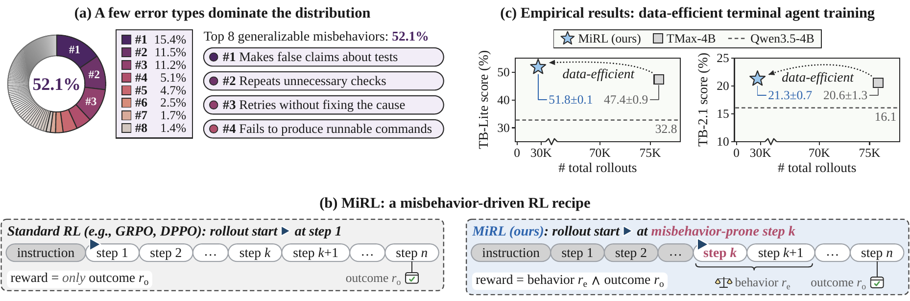

# MiRL: Error-Targeted Reinforcement Learning for Correcting Terminal Agent Misbehaviors

[](https://arxiv.org/abs/2610.35697)
[](https://runchu-tian.github.io/MiRL/)
[](https://huggingface.co/Rtian/MiRL-Qwen3.5-4B)
[](https://huggingface.co/datasets/Rtian/MiRL-train)
[](https://huggingface.co/datasets/Rtian/MiRL-TB2.1-trajectories)
[](LICENSE)

Code for the paper "[MiRL: Error-Targeted Reinforcement Learning for Correcting Terminal Agent Misbehaviors](https://arxiv.org/abs/2610.35697)".

<p align="center"></p>

Terminal agents often repeat the same misbehaviors, such as making false claims about tests or repeating unnecessary checks. Misbehavior-driven RL (MiRL) first profiles the errors of a policy to find these generalizable misbehaviors: kinds of wrong steps that recur across many environments. It then trains the policy with RL, starting rollouts at the steps where these misbehaviors occur, and rewards a rollout only if it passes the tests and avoids the misbehavior. Trained from Qwen3.5-4B on merely 189 environments, MiRL outperforms TMax-4B on Terminal-Bench Lite (51.8% vs. 47.4%) and matches it on Terminal-Bench 2.1 (21.3% vs. 20.6%), with 35% of its rollouts.

## 📢 Progress

We are still improving this GitHub repository and our Hugging Face repositories.

- [Oct 27, 2026] 📄 Our paper is out on [arXiv](https://arxiv.org/abs/2610.35697)!
- [Oct 26, 2026] 🎉 We’ve made an initial release of our [code](https://github.com/runchu-tian/MiRL), [model checkpoint](https://huggingface.co/Rtian/MiRL-Qwen3.5-4B), [data](https://huggingface.co/datasets/Rtian/MiRL-train), and [evaluation trajectories](https://huggingface.co/datasets/Rtian/MiRL-TB2.1-trajectories).

## 🛠️ Installation

### Commands

```bash
git clone https://github.com/runchu-tian/MiRL.git

# MiRL builds on the TMax code (open-instruct, harbor and the TMax agent) at a fixed commit.
git clone https://github.com/hamishivi/tmax.git
cd tmax && git checkout 7387d2f9142397a458dc39f0827a2ab0b4c03cda
uv sync                                  # evaluation environment (harbor and the TMax agent)
cd training/open-instruct && uv sync     # training environment (open-instruct)
```

### Hardware

We used 8x A100 80 GB, 96 CPU threads, about 1 TB of RAM and 5 TB of local disk.

### Packages

We use the Python environments of [TMax](https://github.com/hamishivi/tmax): training uses [`tmax/training/open-instruct/uv.lock`](https://github.com/hamishivi/tmax/blob/7387d2f9142397a458dc39f0827a2ab0b4c03cda/training/open-instruct/uv.lock), and evaluation uses [`tmax/uv.lock`](https://github.com/hamishivi/tmax/blob/7387d2f9142397a458dc39f0827a2ab0b4c03cda/uv.lock).

Besides, the tools we use are:

- [uv](https://docs.astral.sh/uv/) and Python 3.12.
- [Apptainer](https://apptainer.org/) 1.3.4, for the task sandboxes.
- [Docker](https://www.docker.com/), to build the task images.

## 🔍 Error profiling

To locate the errors of the policy, we roll out on a pool of environments and let the teacher replace each error step with a corrected one, so that the rollout can reveal later errors. At each step of a rollout, error profiling goes through four stages:

1. The policy proposes its next step from the current prefix.
2. The error localizer checks the step with its prefix, flags it only if it is likely to lead to failure, and writes a short explanation.
3. For a flagged step, the teacher writes a correction from the same prefix, so that the rollout can continue without being pushed into incorrect states. The correction is checked in the same way as a step of the policy.
4. The accepted step, either the policy's own step or a correction from the teacher, is executed, and the rollout returns to (1) for the next step.

### Setup

Before the rollouts, we download the TMax tasks and build one Apptainer sandbox per task.

```bash
bash mirl/profiling/prepare_tasks.sh /path/to/profiling
```

If your machine is itself a container, Apptainer's `--fakeroot` and `--userns` may fail to mount `/proc`. Then you can add `--nested` here and to `scripts/profile.sh` below, so that the sandboxes run without the two flags.

### Rollouts

We run error profiling on 2,017 random terminal environments from TMax's environment set ([`mirl/profiling/environments.json`](mirl/profiling/environments.json)). The policy is [Qwen3.5-4B](https://huggingface.co/Qwen/Qwen3.5-4B), and the error localizer and the teacher are both [Qwen3.8-27B](https://huggingface.co/Qwen/Qwen3.8-27B). Their prompts are in [`mirl/profiling/teacher.py`](mirl/profiling/teacher.py).

`scripts/profile.sh` serves the policy on GPUs 0-1 and the teacher on GPUs 2-7 with vLLM, and runs the rollouts. We run it with two seeds.

```bash
bash scripts/profile.sh --tasks-dir /path/to/profiling/tasks --seed 1 --out runs/profiling_seed1
```

Add `--limit 3` for a quick test on the first three environments. Run `bash scripts/profile.sh --help` for all options.

Each rollout writes two files. `io/<task>_r<row>.json` records every call of the policy, the error localizer and the teacher, and every executed command, and `traj/<task>_r<row>.json` holds the final messages, the statistics of the rollout and the test result.

If the teacher fails to give a correction that passes the error localizer within three tries, the `io` file records a `k_cap_hit`, and the rollout is discarded later when we build the prefixes.

### Error taxonomy

To find the errors that recur across environments, we group the error steps into error types.

The annotator is [Claude Opus 5](https://www.anthropic.com/claude-opus-5-system-card).

Install the SDK with `pip install anthropic==2.3.0` and set `ANTHROPIC_API_KEY`.

```bash
T=runs/taxonomy
python mirl/profiling/taxonomy.py errors  --io runs/profiling_seed1/io runs/profiling_seed2/io --out $T
python mirl/profiling/taxonomy.py propose --size N --out $T
python mirl/profiling/taxonomy.py refine  --batches B --size N --out $T
python mirl/profiling/taxonomy.py select  --min-batches K --out $T
python mirl/profiling/taxonomy.py label   --size N --out $T
```

| Option | Meaning |
|---|---|
| `--size` | error steps per batch |
| `--batches` | total number of batches, the first one included |
| `--min-batches` | keep a type only if it appears in at least this many batches |
| `--min-share` | keep the types that cover at least this share of the error steps |

In the paper, we used `--size 300` in all stages, `--batches 3`, and `--min-batches 3`. In our practice, we ran the annotator as a Claude Code agent, so these settings may need adjustment when using the API.

`types.json` holds the types that recur across batches, each with two examples. `labels.jsonl` holds the types of every error step, and `misbehaviors.json` holds the types that are kept.

## ✂️ Misbehavior prefixes

We select a fixed number of misbehavior prefixes for each misbehavior to form the training data. We rerun the commands of each prefix step by step in a fresh container of its environment, and keep the prefix only if every command returns exactly the same output as in the prefix.

```bash
python mirl/prefixes/sample.py --taxonomy runs/taxonomy --io runs/profiling_seed1/io runs/profiling_seed2/io --out runs/prefixes
bash scripts/rerun.sh --prefixes runs/prefixes/prefixes.jsonl --tasks-dir /path/to/profiling/tasks --out runs/prefixes
```

Each sandbox gets its own network, which needs root. If this does not work on your machine, add `--no-net-bridge`, but some prefixes may then fail the check because of port collisions. Run `bash scripts/rerun.sh --help` for all options.

`prefixes_rerun.jsonl` holds the kept prefixes, and their environments are the training environments. Our training prefixes are released in [Rtian/MiRL-train](https://huggingface.co/datasets/Rtian/MiRL-train).

## 🎯 MiRL training

The behavior judge is [Gemini 3.8 Flash](https://ai.google.dev/gemini-api/docs/models/gemini-3.8-flash), which reads the m=5 steps after the prefix. Set `GEMINI_API_KEY` before training.

```bash
bash mirl/train/install.sh
python mirl/train/build_rows.py --prefixes runs/prefixes/prefixes_rerun.jsonl --taxonomy runs/taxonomy --out runs/train_data/train.jsonl
bash scripts/train.sh --data runs/train_data --tasks-dir /path/to/profiling/tasks --out runs/mirl
```

`install.sh` patches the TMax checkout and adds the MiRL environment and reward to open-instruct. (Without `sudo`, the sandboxes share the host network, and tasks that bind fixed ports may conflict.) Checkpoints are saved every 5 steps in `runs/mirl/model`. Our checkpoint is released in [Rtian/MiRL-Qwen3.5-4B](https://huggingface.co/Rtian/MiRL-Qwen3.5-4B).

### Ablations

We ablate MiRL by adding its three parts one at a time to TMax-189. TMax-189 replicates the TMax recipe but only on 189 environments: it starts rollouts at the beginning of each task and uses the outcome reward.

```bash
# TMax-189
python mirl/train/build_rows.py --random-envs 189 --tasks-dir /path/to/profiling/tasks --start task --reward outcome --out runs/tmax189/train.jsonl
# + environment selection
python mirl/train/build_rows.py --prefixes runs/prefixes/prefixes_rerun.jsonl --taxonomy runs/taxonomy --start task --reward outcome --out runs/env_selection/train.jsonl
# + prefix start
python mirl/train/build_rows.py --prefixes runs/prefixes/prefixes_rerun.jsonl --taxonomy runs/taxonomy --reward outcome --out runs/prefix_start/train.jsonl
```

Train each with `scripts/train.sh` as above.

## 🔬 Misbehavior rate

To verify that MiRL reduces the misbehaviors, we measure how often each policy repeats a misbehavior before and after training.

```bash
python mirl/analysis/unseen.py --prefixes runs/prefixes/prefixes.jsonl --train runs/prefixes/prefixes_rerun.jsonl --modes "<misbehavior 1>" "<misbehavior 2>" ... --out runs/rate/unseen.jsonl
bash scripts/misbehavior_rate.sh --set runs/rate/unseen.jsonl --taxonomy runs/taxonomy --out runs/rate
```

`--modes` takes misbehavior names from `misbehaviors.json`. `rates.md` holds the misbehavior rate of each judge, policy, and misbehavior.

## 📊 Evaluation

We evaluate on [Terminal-Bench Lite](https://www.openthoughts.ai/blog/openthoughts-tblite) and [Terminal-Bench 2.1](https://www.tbench.ai/news/terminal-bench-2-1) with [Vanillux2Agent](https://github.com/hamishivi/tmax/blob/7387d2f9142397a458dc39f0827a2ab0b4c03cda/Vanillux2Agent/agent.py). Key parameters can be found in Table 1 of the paper or the code. 

Before the first evaluation, download the two benchmarks and build one Apptainer sandbox per task (about 105 GB for the 189 tasks). Building needs Docker permission.

```bash
export TMAX_DIR=/path/to/tmax APPTAINER_EVAL_DIR=/path/to/workdir
bash mirl/eval/download_benchmarks.sh /path/to/benchmarks
export TBLITE_DIR=/path/to/benchmarks/openthoughts-tblite/openthoughts-tblite
export TB21_DIR=/path/to/benchmarks/terminal-bench-2-1/terminal-bench-2-1
bash mirl/eval/build_sandboxes.sh all
```

To run the sandboxes without `sudo`, set `APPTAINER_EVAL_ROOTLESS=1` (see `mirl/eval/apptainer_env.py`).

To evaluate a model, run `scripts/eval.sh`. It starts one vLLM server per GPU and runs the evaluation runs in parallel. For example, 3 runs of MiRL on TB-2.1:

```bash
bash scripts/eval.sh --model Rtian/MiRL-Qwen3.5-4B --bench tb21 --runs 3
```

| Option | Meaning | Default |
|---|---|---|
| `--model` | model checkpoint, a local directory or a Hugging Face id | required |
| `--bench` | `tblite` or `tb21` | required |
| `--name` | served model name and prefix of the run names | name of the checkpoint |
| `--runs` | number of runs (seeds) | 3 |
| `--gpus` | GPUs to use, comma-separated | `0,1,2,3,4,5,6,7` |
| `--nc` | tasks at once per GPU | 8 |
| `--out` | output directory | `runs` |
| `--port` | port of the server on the first GPU; the next GPUs use the next ports | 8700 |

Results in the paper (mean ± standard error):

| Model | TB-Lite (3 runs) | TB-2.1 (3 runs) | TB-2.1 (16 runs) |
|---|---|---|---|
| Qwen3.5-4B | 32.8 ± 1.5 | 16.1 ± 1.0 | 14.2 ± 0.6 |
| TMax-4B | 47.4 ± 0.9 | 20.6 ± 1.3 | 20.2 ± 0.7 |
| MiRL | 51.8 ± 0.1 | 21.3 ± 0.7 | 21.1 ± 0.5 |

Our model checkpoint is released in [Rtian/MiRL-Qwen3.5-4B](https://huggingface.co/Rtian/MiRL-Qwen3.5-4B). The trajectories of the 16 TB-2.1 runs of Qwen3.5-4B, TMax-4B, and MiRL are released in [Rtian/MiRL-TB2.1-trajectories](https://huggingface.co/datasets/Rtian/MiRL-TB2.1-trajectories).

> **Warning: the concurrency of the evaluation can change the score.**
> With more tasks at once, each sandbox gets less CPU and each model step takes longer. More tasks then hit their time limits and score 0. Set the concurrency (`--nc`) to fit your machine; our default may not suit it. Besides, the score on terminal tasks also depends strongly on the server, the sandbox configuration, and the hardware.

## 🗂️ Repository structure

```
mirl/
  profiling/   error profiling: rollouts, error localizer, teacher, annotator          (paper §3.2-3.3)
  prefixes/    misbehavior prefixes and the rerun check                                (§3.4, §4.1)
  train/       MiRL training: rollouts from prefixes, reward r_o AND r_e               (§3.4-3.5, Appendix A)
  eval/        TB-Lite and TB-2.1 evaluation and scoring                               (§4.1)
  analysis/    misbehavior rate on unseen prefixes                                     (§4.5)
prompts/       prompts of the error localizer, teacher, annotator and behavior judge   (Appendix A)
scripts/       launch scripts
assets/        figures for this README
```

## 📝 Citation

```bibtex
@misc{tian2026mirlerrortargetedreinforcementlearning,
      title={MiRL: Error-Targeted Reinforcement Learning for Correcting Terminal Agent Misbehaviors}, 
      author={Runchu Tian and Zaid Khan and Zun Wang and Justin Chih-Yao Chen and Mohit Bansal},
      year={2026},
      eprint={2610.35697},
      archivePrefix={arXiv},
      primaryClass={cs.LG},
      url={https://arxiv.org/abs/2610.35697}, 
}
```

## ⚖️ License

The code is released under the [Apache 2.0 license](LICENSE).
